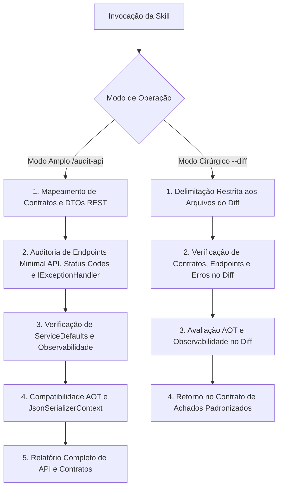

# Auditoria de API e Contratos REST (Audit API)

Runbook operacional especializado para auditar a superfície de comunicação backend, contratos e transporte da solução: contratos de dados imutáveis em `CxManager.Contract`, serialização `System.Text.Json` Source Generation compatível com Native AOT, endpoints Minimal API sob `/api`, `TypedResults`, `IExceptionHandler` global e observabilidade de serviços em `CxManager.ServiceDefaults`.

---

## Modos de Operação Transparentes

A skill opera em dois modos distintos de execução:

### 1. Modo Amplo (Full Audit)
Invocação manual para análise da superfície de contratos, APIs e observabilidade da solução completa ou de um módulo específico:
```bash
/audit-api
/audit-api [caminho_ou_camada]
```
- Produz o relatório analítico completo de conformidade de APIs e contratos REST.

### 2. Modo Cirúrgico / Focado (Scoped Audit)
Invocação com escopo restrito aos arquivos alterados no diff (utilizado primordialmente pelo orquestrador de `code-review` via subagente):
```bash
/audit-api --diff
/audit-api --diff [lista_de_arquivos]
```
- Analisa exclusivamente as alterações do diff com isolamento de contexto e retorna os achados estritamente dentro do **Contrato de Achados Padronizados**.

---

## Regras de Governança Aplicáveis

A avaliação de contratos, APIs e transporte é regida integralmente pelas regras documentadas em [.agents/rules/](../../rules/):

- **Contratos REST**: Seguir integralmente [.agents/rules/contracts-rules.md](../../rules/contracts-rules.md).
- **Integridade de Dados & Simetria de Tipos**: Seguir integralmente [.agents/rules/data-integrity-rules.md](../../rules/data-integrity-rules.md).
- **APIs**: Seguir integralmente [.agents/rules/api-rules.md](../../rules/api-rules.md).
- **ServiceDefaults**: Seguir integralmente [.agents/rules/service-defaults-rules.md](../../rules/service-defaults-rules.md).
- **Convenções C# & AOT**: Seguir integralmente [.agents/rules/csharp-conventions.md](../../rules/csharp-conventions.md).

---

## Orquestração de Recursos Globais por Plugin

A skill `audit-api` orquestra as seguintes ferramentas especializadas instaladas globalmente:

### Plugin `dotnet-aspnetcore`
- Skill `dotnet-webapi`

### Plugin `dotnet-diag`
- Subagente `optimizing-dotnet-performance`
- Skill `analyzing-dotnet-performance`

### Plugin `dotnet`
- Skill `csharp-expert`

---

## Fluxo de Execução da Auditoria



---

## Passos de Execução: Modo Amplo (Full Audit)

### Passo 1: Contratos REST e DTOs Imutáveis
Avaliar contratos de requisição e resposta, imutabilidade, paginação e envelope de erro em conformidade com [.agents/rules/contracts-rules.md](../../rules/contracts-rules.md) e [.agents/rules/csharp-conventions.md](../../rules/csharp-conventions.md).

### Passo 2: Endpoints Minimal API, Status Codes e Tratamento de Erros
Auditar grupos de rotas, `TypedResults`, status codes e mapeamento de exceções em `IExceptionHandler` em conformidade com [.agents/rules/api-rules.md](../../rules/api-rules.md) e a skill `dotnet-webapi`.

### Passo 3: ServiceDefaults e Observabilidade
Verificar a instrumentação de métricas, traces, health checks e resiliência HTTP de acordo com [.agents/rules/service-defaults-rules.md](../../rules/service-defaults-rules.md).

### Passo 4: Compatibilidade com Compilação Native AOT
Avaliar o registro completo de tipos no `JsonSerializerContext` e a ausência de reflexão dinâmica nos endpoints e na composição de DI em conformidade com [.agents/rules/api-rules.md](../../rules/api-rules.md) e [.agents/rules/csharp-conventions.md](../../rules/csharp-conventions.md).

---

## Passos de Execução: Modo Cirúrgico / Focado (`--diff`)

Quando invocado via subagente a partir do `code-review` ou diretamente com `--diff`:

1. **Delimitação Cirúrgica**: Filtrar estritamente os arquivos modificados na sessão/diff pertencentes às camadas de contratos, APIs e ServiceDefaults.
2. **Verificação de Contratos e DTOs no Diff**: Analisar contratos alterados em conformidade com [.agents/rules/contracts-rules.md](../../rules/contracts-rules.md) e sua sincronia com `JsonSerializerContext`.
3. **Verificação de Endpoints e Tratamento de Erros no Diff**: Avaliar novos endpoints, mapeamentos ou handlers de erro utilizando `dotnet-webapi` e [.agents/rules/api-rules.md](../../rules/api-rules.md).
4. **Verificação de Observabilidade no Diff**: Avaliar configurações de telemetria e resiliência conforme [.agents/rules/service-defaults-rules.md](../../rules/service-defaults-rules.md).
5. **Emissão de Retorno Padronizado**: Estruturar a resposta estritamente conforme o **Contrato de Achados Padronizados**.

---

## Contrato de Achados Padronizados (Modo Cirúrgico / Focado)

No modo cirúrgico (`--diff`), o subagente deve responder estritamente com a estrutura abaixo, sem relatórios visuais prolixos:

### 1. Síntese Executiva
Um parágrafo conciso resumindo o estado de conformidade técnica dos contratos REST, endpoints Minimal API, serialização AOT e observabilidade avaliados no diff.

### 2. Lista de Achados Padronizados
Cada ocorrência deve seguir o formato exato aceito pelo `code-review`, categorizada na dimensão `[API & Contratos REST]`:

> **[Severidade] [API & Contratos REST]** Título objetivo do achado
> - **Localização**: `caminho/do/arquivo:linha`
> - **Comportamento Atual**: Descrição factual do que foi implementado.
> - **Impacto / Risco Técnico**: Explicação técnica do impacto (incompatibilidade de contrato, status code divergente, falha de serialização AOT, brecha em handler de erro ou ausência de telemetria).
> - **Ação Recomendada**: O que deve ser ajustado, acompanhado do trecho de código/diff sugerido.

### 3. Recomendação Formal de Auditoria Ampla
Se durante a análise do diff forem identificadas inconsistências sistêmicas em contratos, falhas de transporte ou desalinhamento entre endpoints que extrapolem o escopo imediato das linhas alteradas, incluir recomendação formal:
> ⚠️ **Recomendação**: Inconsistências de contratos, APIs ou observabilidade identificadas fora do escopo cirúrgico. Recomenda-se executar `/audit-api [escopo]` para uma varredura completa.

---

## Estrutura do Relatório de Auditoria Completa (Modo Amplo)

Ao concluir a auditoria no modo amplo, apresentar o resumo estruturado:

### 🔌 Relatório de Auditoria de APIs e Contratos REST

#### Resumo Executivo
- **Escopo Auditado**: [Caminho / Camadas]
- **Status Geral**: [🟢 Conforme | 🟡 Alertas | 🔴 Crítico]
- **Principais Oportunidades Identificadas**: [Resumo objetivo em 1-2 frases]

#### 1. Contratos REST e DTOs Imutáveis
- Avaliação da imutabilidade, tipagem forte e fidelidade aos shapes do contrato.

#### 2. Endpoints Minimal API, Status Codes e IExceptionHandler
- Avaliação de mapeamentos de rota, `TypedResults` e tratamento global de erros.

#### 3. Observabilidade e ServiceDefaults
- Avaliação de métricas, traces OpenTelemetry, health checks e resiliência de transporte.

#### 4. Compatibilidade Native AOT e Serialização JSON
- Avaliação do `JsonSerializerContext` e ausência de reflexão dinâmica.

#### 5. Achados Detalhados
Cada ocorrência deve seguir o formato padronizado aceito pelo `code-review`:

> **[Severidade] [API & Contratos REST]** Título objetivo do achado
> - **Localização**: `caminho/do/arquivo:linha`
> - **Comportamento Atual**: Descrição factual da inconformidade.
> - **Impacto / Risco Técnico**: Explicação técnica do risco à comunicação ou conformidade.
> - **Ação Recomendada**: O que deve ser ajustado conforme as regras do CxManager.

#### 6. Plano de Ação Prioritário
1. [Correção de inconsistências de contratos ou serialização AOT]
2. [Ajustes de endpoints, status codes e handlers de erro]
3. [Padronização de observabilidade]
