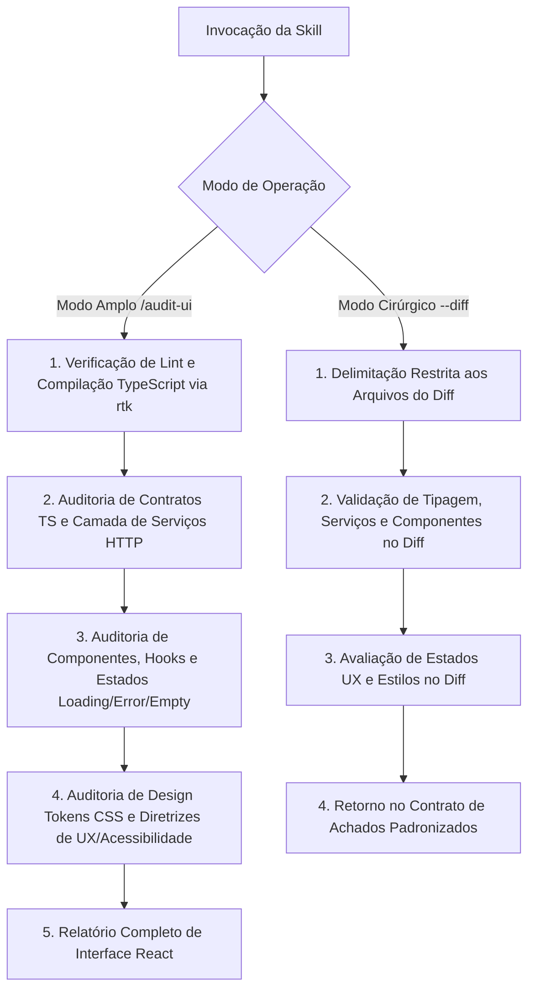

# Auditoria de Interface e Componentes React (Audit UI)

Runbook operacional especializado para auditar a camada de apresentação frontend em `src/frontend` (React 19 + TypeScript 7 + MUI Material v9 + Vite 8 + Oxlint Type-Aware): contratos TypeScript espelhados com o backend, isolamento da camada de serviços HTTP com `AbortSignal`, composição de componentes e hooks, tratamento de estados intermediários (`loading`, `error`, `empty`), padronização de tema MUI, acessibilidade e fluidez de experiência do usuário.

---

## Modos de Operação Transparentes

A skill opera em dois modos distintos de execução:

### 1. Modo Amplo (Full Audit)
Invocação manual para análise estrutural e de interface do frontend completo ou de um módulo/componente específico:
```bash
/audit-ui
/audit-ui [caminho_ou_componente]
```
- Produz o relatório analítico completo de interface e componentes React.

### 2. Modo Cirúrgico / Focado (Scoped Audit)
Invocação com escopo restrito aos arquivos alterados no diff (utilizado primordialmente pelo orquestrador de `code-review` via subagente):
```bash
/audit-ui --diff
/audit-ui --diff [lista_de_arquivos]
```
- Analisa exclusivamente as alterações do diff com isolamento de contexto e retorna os achados estritamente dentro do **Contrato de Achados Padronizados**.

---

## Regras de Governança Aplicáveis

A avaliação de interface e componentes frontend é regida integralmente pelas regras documentadas em [.agents/rules/](../../rules/):

- **Frontend React & TypeScript**: Seguir integralmente [.agents/rules/frontend-rules.md](../../rules/frontend-rules.md).
- **Contratos REST**: Seguir integralmente [.agents/rules/contracts-rules.md](../../rules/contracts-rules.md).
- **Integridade de Dados & Simetria de Tipos**: Seguir integralmente [.agents/rules/data-integrity-rules.md](../../rules/data-integrity-rules.md).
- **Arquitetura Geral**: Seguir integralmente [.agents/rules/architecture.md](../../rules/architecture.md).

---

## Orquestração de Recursos Globais

A skill `audit-ui` orquestra as seguintes skills e servidores MCP instalados globalmente:

### Skills Globais de Frontend e Design
- Skill `vercel-react-best-practices`
- Skill `vercel-composition-patterns`
- Skill `vercel-react-view-transitions`
- Skill `web-design-guidelines`

### Servidores MCP
- `mui-mcp`
- `playwright`
- `chrome-devtools`

---

## Fluxo de Execução da Auditoria



---

## Passos de Execução: Modo Amplo (Full Audit)

### Passo 1: Validação Estática e Lint (CLI)
Executar a verificação de tipos TypeScript e lint no diretório `src/frontend` utilizando o proxy `rtk`:
```bash
rtk npm --prefix src/frontend run lint
rtk npm --prefix src/frontend run build
```

### Passo 2: Contratos TypeScript e Isolamento da Camada de Serviços
Auditar a fidelidade dos tipos em `src/frontend/src/types/` frente a [.agents/rules/contracts-rules.md](../../rules/contracts-rules.md) e o isolamento das chamadas HTTP em `src/frontend/src/services/` em conformidade com [.agents/rules/frontend-rules.md](../../rules/frontend-rules.md).

### Passo 3: Componentes React, Hooks e Estados Obrigatórios
Avaliar a decomposição de componentes, gerenciamento de estado, ciclo de vida e tratamento dos estados `loading`, `error` e `empty` acionando as skills `vercel-react-best-practices` e `vercel-composition-patterns`, em conformidade com [.agents/rules/frontend-rules.md](../../rules/frontend-rules.md).

### Passo 4: Tokens CSS, UX e Acessibilidade
Verificar a centralização de tokens CSS, ausência de estilos inline hardcoded, confirmação de ações destrutivas, debounce de busca e conformidade com `web-design-guidelines`.

---

## Passos de Execução: Modo Cirúrgico / Focado (`--diff`)

Quando invocado via subagente a partir do `code-review` ou diretamente com `--diff`:

1. **Delimitação Cirúrgica**: Filtrar estritamente os arquivos modificados na sessão/diff pertencentes a `src/frontend/**` e executar `rtk npm --prefix src/frontend run lint`.
2. **Verificação de Contratos, Serviços e Componentes no Diff**: Analisar os arquivos `.ts` e `.tsx` alterados em conformidade com [.agents/rules/frontend-rules.md](../../rules/frontend-rules.md), acionando `vercel-react-best-practices` e `vercel-composition-patterns`.
3. **Verificação de Estados de UX e Estilos no Diff**: Avaliar o tratamento de `loading`, `error` e `empty`, aderência aos tokens CSS e diretrizes de `web-design-guidelines`.
4. **Emissão de Retorno Padronizado**: Estruturar a resposta estritamente conforme o **Contrato de Achados Padronizados**.

---

## Contrato de Achados Padronizados (Modo Cirúrgico / Focado)

No modo cirúrgico (`--diff`), o subagente deve responder estritamente com a estrutura abaixo, sem relatórios visuais prolixos:

### 1. Síntese Executiva
Um parágrafo conciso resumindo o estado de conformidade técnica dos componentes React, tipagem TypeScript, isolamento de dados e experiência de usuário avaliados no diff.

### 2. Lista de Achados Padronizados
Cada ocorrência deve seguir o formato exato aceito pelo `code-review`, categorizada na dimensão `[Interface & Componentes React]`:

> **[Severidade] [Interface & Componentes React]** Título objetivo do achado
> - **Localização**: `caminho/do/arquivo:linha`
> - **Comportamento Atual**: Descrição factual do que foi implementado.
> - **Impacto / Risco Técnico**: Explicação técnica do impacto (uso de `any`, `fetch` acoplado ao componente, ausência de tratamento de erro/loading/empty, re-renderização desnecessária ou estilo hardcoded).
> - **Ação Recomendada**: O que deve ser ajustado, acompanhado do trecho de código/diff sugerido.

### 3. Recomendação Formal de Auditoria Ampla
Se durante a análise do diff forem identificadas inconsistências visuais recorrentes, quebra no sistema de tipos ou acoplamentos que extrapolem o escopo imediato das linhas alteradas, incluir recomendação formal:
> ⚠️ **Recomendação**: Inconsistências visuais, de estado ou acoplamentos em componentes de interface identificados fora do escopo cirúrgico. Recomenda-se executar `/audit-ui [escopo]` para uma varredura completa.

---

## Estrutura do Relatório de Auditoria Completa (Modo Amplo)

Ao concluir a auditoria no modo amplo, apresentar o resumo estruturado:

### 🎨 Relatório de Auditoria de Interface & Componentes React

#### Resumo Executivo
- **Escopo Auditado**: [Caminho / Módulos]
- **Status Geral**: [🟢 Conforme | 🟡 Alertas | 🔴 Crítico]
- **Principais Oportunidades Identificadas**: [Resumo objetivo em 1-2 frases]

#### 1. Contratos TypeScript e Camada de Serviços HTTP
- Avaliação de tipagem estrita (`readonly`, zero `any`), sincronia com o backend e propagação de `AbortSignal`.

#### 2. Arquitetura de Componentes e Hooks React 19
- Avaliação de modularidade, composição e fluxo de estado.

#### 3. Estados de UX (`Loading`, `Error`, `Empty`) e Interações
- Avaliação de resiliência visual, confirmação de exclusão, paginação e debounce de busca.

#### 4. Design Tokens CSS e Acessibilidade
- Avaliação de variáveis CSS centralizadas e conformidade com `web-design-guidelines`.

#### 5. Achados Detalhados
Cada ocorrência deve seguir o formato padronizado aceito pelo `code-review`:

> **[Severidade] [Interface & Componentes React]** Título objetivo do achado
> - **Localização**: `caminho/do/arquivo:linha`
> - **Comportamento Atual**: Descrição factual da inconformidade.
> - **Impacto / Risco Técnico**: Explicação técnica do risco à experiência de usuário ou manutenibilidade.
> - **Ação Recomendada**: O que deve ser ajustado conforme as regras do CxManager.

#### 6. Plano de Ação Prioritário
1. [Correção de falhas de estado (loading/error/empty) ou contratos TypeScript]
2. [Ajustes de composição de componentes, hooks e cancelamento de requisições]
3. [Padronização de tokens CSS e acessibilidade]
