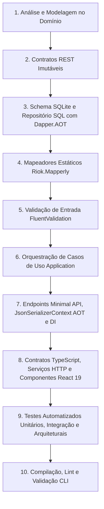

# Propagação de Funcionalidade Ponta a Ponta (Propagate Feature)

Runbook operacional para guiar a propagação consistente de uma entidade ou funcionalidade através de todas as camadas impactadas da solução CxManager: modelagem de domínio, contratos REST imutáveis, persistência e queries escritas à mão com Dapper.AOT no SQLite, mapeamentos em tempo de compilação com Riok.Mapperly, validações de entrada com FluentValidation, orquestração de casos de uso na camada Application, exposição de endpoints Minimal API com `JsonSerializerContext` AOT, consumo fortemente tipado no frontend React 19 + TypeScript 7 + MUI Material v9 e suíte abrangente de testes automatizados.

## Como Usar
Invoque esta skill utilizando o comando:
```bash
/propagate-feature [NomeDaFeatureOuEntidade]
```

---

## Fluxo de Execução



---

## 1. Análise e Modelagem no Domínio (CxManager.Domain)

- **Localização**:
  - `src/backend/CxManager/CxManager.Domain/Entities/`
  - `src/backend/CxManager/CxManager.Domain/Interfaces/`
  - `src/backend/CxManager/CxManager.Domain/Exceptions/`
- **Regras Aplicáveis**:
  - [.agents/rules/domain-rules.md](../../rules/domain-rules.md)
  - [.agents/rules/data-integrity-rules.md](../../rules/data-integrity-rules.md)
  - [.agents/rules/architecture.md](../../rules/architecture.md)
  - [.agents/rules/csharp-conventions.md](../../rules/csharp-conventions.md)
- **Ferramentas Globais**:
  - Plugin `ponytail`: skill `ponytail`
  - Plugin `dotnet-diag`: subagente `optimizing-dotnet-performance`, skill `analyzing-dotnet-performance`
- **Diretrizes de Orquestração**:
  - Modelar entidades, interfaces de repositório e exceções de domínio em conformidade estrita com [.agents/rules/domain-rules.md](../../rules/domain-rules.md) e [.agents/rules/data-integrity-rules.md](../../rules/data-integrity-rules.md).
  - Consultar e seguir integralmente [.agents/rules/architecture.md](../../rules/architecture.md) e [.agents/rules/csharp-conventions.md](../../rules/csharp-conventions.md).

---

## 2. Propagação e Modelagem de Contratos REST (CxManager.Contract)

- **Localização**:
  - `src/backend/CxManager/CxManager.Contract/Requests/[Feature]/`
  - `src/backend/CxManager/CxManager.Contract/Responses/[Feature]/`
- **Regras Aplicáveis**:
  - [.agents/rules/contracts-rules.md](../../rules/contracts-rules.md)
  - [.agents/rules/data-integrity-rules.md](../../rules/data-integrity-rules.md)
  - [.agents/rules/architecture.md](../../rules/architecture.md)
  - [.agents/rules/csharp-conventions.md](../../rules/csharp-conventions.md)
- **Ferramentas Globais**:
  - Plugin `dotnet-diag`: subagente `optimizing-dotnet-performance`, skill `analyzing-dotnet-performance`
  - Plugin `ponytail`: skill `ponytail`
- **Diretrizes de Orquestração**:
  - Modelar os contratos de requisição e resposta REST em conformidade estrita com [.agents/rules/contracts-rules.md](../../rules/contracts-rules.md).
  - Consultar e seguir integralmente [.agents/rules/architecture.md](../../rules/architecture.md) e [.agents/rules/csharp-conventions.md](../../rules/csharp-conventions.md).

---

## 3. Schema SQLite e Repositórios SQL com Dapper.AOT (CxManager.Infrastructure)

- **Localização**:
  - `src/backend/CxManager/CxManager.Infrastructure/Persistence/Schema/`
  - `src/backend/CxManager/CxManager.Infrastructure/Persistence/Repositories/`
  - `src/backend/CxManager/CxManager.Infrastructure/DependencyInjection.cs`
- **Regras Aplicáveis**:
  - [.agents/rules/infrastructure-rules.md](../../rules/infrastructure-rules.md)
  - [.agents/rules/data-integrity-rules.md](../../rules/data-integrity-rules.md)
  - [.agents/rules/csharp-conventions.md](../../rules/csharp-conventions.md)
- **Ferramentas Globais**:
  - Plugin `dotnet-diag`: subagente `optimizing-dotnet-performance`, skill `analyzing-dotnet-performance`
  - Plugin `ponytail`: skill `ponytail`
- **Diretrizes de Orquestração**:
  - Implementar o schema relacional SQLite, índices documentados e classes concretas de repositório com SQL parametrizado e `Dapper.AOT` em conformidade estrita com [.agents/rules/infrastructure-rules.md](../../rules/infrastructure-rules.md).
  - Assegurar o cumprimento integral das invariantes de soft delete (`deleted_at IS NULL`) e isolamento de escalas definidas em [.agents/rules/data-integrity-rules.md](../../rules/data-integrity-rules.md).

---

## 4. Mapeadores Estáticos em Tempo de Compilação com Riok.Mapperly (CxManager.Application)

- **Localização**: `src/backend/CxManager/CxManager.Application/Mappers/`
- **Regras Aplicáveis**:
  - [.agents/rules/application-rules.md](../../rules/application-rules.md)
  - [.agents/rules/architecture.md](../../rules/architecture.md)
  - [.agents/rules/csharp-conventions.md](../../rules/csharp-conventions.md)
- **Ferramentas Globais**:
  - Plugin `dotnet-diag`: subagente `optimizing-dotnet-performance`, skill `analyzing-dotnet-performance`
  - Plugin `ponytail`: skill `ponytail`
- **Diretrizes de Orquestração**:
  - Implementar classes estáticas parciais de mapeamento com geração em tempo de compilação em conformidade estrita com [.agents/rules/application-rules.md](../../rules/application-rules.md).

---

## 5. Validação de Entrada com FluentValidation (CxManager.Application)

- **Localização**: `src/backend/CxManager/CxManager.Application/Validators/[Feature]/`
- **Regras Aplicáveis**:
  - [.agents/rules/application-rules.md](../../rules/application-rules.md)
  - [.agents/rules/architecture.md](../../rules/architecture.md)
  - [.agents/rules/csharp-conventions.md](../../rules/csharp-conventions.md)
- **Ferramentas Globais**:
  - Plugin `ponytail`: skill `ponytail`
- **Diretrizes de Orquestração**:
  - Implementar validadores fortemente tipados e registrá-los explicitamente sem reflexão em conformidade estrita com [.agents/rules/application-rules.md](../../rules/application-rules.md).

---

## 6. Orquestração de Casos de Uso (CxManager.Application)

- **Localização**:
  - `src/backend/CxManager/CxManager.Application/UseCases/[Feature]/Commands/`
  - `src/backend/CxManager/CxManager.Application/UseCases/[Feature]/Queries/`
- **Regras Aplicáveis**:
  - [.agents/rules/application-rules.md](../../rules/application-rules.md)
  - [.agents/rules/data-integrity-rules.md](../../rules/data-integrity-rules.md)
  - [.agents/rules/architecture.md](../../rules/architecture.md)
  - [.agents/rules/csharp-conventions.md](../../rules/csharp-conventions.md)
- **Ferramentas Globais**:
  - Plugin `dotnet-diag`: subagente `optimizing-dotnet-performance`, skill `analyzing-dotnet-performance`
  - Plugin `ponytail`: skills `ponytail`, `ponytail-review`
- **Diretrizes de Orquestração**:
  - Implementar os casos de uso isolados (`sealed`) com `ExecuteAsync` em conformidade estrita com [.agents/rules/application-rules.md](../../rules/application-rules.md) e [.agents/rules/data-integrity-rules.md](../../rules/data-integrity-rules.md).

---

## 7. Endpoints Minimal API, Serialização AOT e Injeção de Dependências (CxManager.Api)

- **Localização**:
  - `src/backend/CxManager/CxManager.Api/Endpoints/[Feature]Endpoints.cs`
  - `src/backend/CxManager/CxManager.Api/Serialization/AppJsonSerializerContext.cs`
  - `src/backend/CxManager/CxManager.Api/Extensions/`
- **Regras Aplicáveis**:
  - [.agents/rules/api-rules.md](../../rules/api-rules.md)
  - [.agents/rules/contracts-rules.md](../../rules/contracts-rules.md)
  - [.agents/rules/architecture.md](../../rules/architecture.md)
  - [.agents/rules/csharp-conventions.md](../../rules/csharp-conventions.md)
- **Ferramentas Globais**:
  - Plugin `dotnet-aspnetcore`: skill `dotnet-webapi`
  - Plugin `dotnet-diag`: subagente `optimizing-dotnet-performance`, skill `analyzing-dotnet-performance`
  - Plugin `ponytail`: skill `ponytail`
- **Diretrizes de Orquestração**:
  - Mapear os endpoints Minimal API utilizando `TypedResults`, registrar os DTOs em `AppJsonSerializerContext` e registrar explicitamente os casos de uso e validadores no contêiner de DI em conformidade estrita com [.agents/rules/api-rules.md](../../rules/api-rules.md).

---

## 8. Contratos TypeScript, Camada de Serviços HTTP e UI React 19 (`src/frontend`)

- **Localização**:
  - `src/frontend/src/types/`
  - `src/frontend/src/services/`
  - `src/frontend/src/hooks/`
  - `src/frontend/src/components/`
  - `src/frontend/src/pages/`
- **Regras Aplicáveis**:
  - [.agents/rules/frontend-rules.md](../../rules/frontend-rules.md)
  - [.agents/rules/contracts-rules.md](../../rules/contracts-rules.md)
  - [.agents/rules/data-integrity-rules.md](../../rules/data-integrity-rules.md)
- **Ferramentas Globais**:
  - Servidor MCP `mui-mcp`
  - Skills `vercel-react-best-practices`, `vercel-composition-patterns`, `vercel-react-view-transitions`, `web-design-guidelines`
  - Plugin `ponytail`: skill `ponytail`
- **Diretrizes de Orquestração**:
  - Espelhar os contratos em TypeScript estrito (`readonly`), implementar as chamadas HTTP com `AbortSignal` em `services/` e construir os componentes tratando obrigatoriamente os estados `loading`, `error` e `empty` em conformidade estrita com [.agents/rules/frontend-rules.md](../../rules/frontend-rules.md).

---

## 9. Escrita e Auditoria dos Testes Automatizados

- **Localização**:
  - `src/backend/CxManager/CxManager.UnitTests/`
  - `src/backend/CxManager/CxManager.IntegrationTests/`
  - `src/backend/CxManager/CxManager.ArchitectureTests/`
- **Regras Aplicáveis**:
  - [.agents/rules/unit-testing-rules.md](../../rules/unit-testing-rules.md)
  - [.agents/rules/integration-testing-rules.md](../../rules/integration-testing-rules.md)
  - [.agents/rules/architecture-testing-rules.md](../../rules/architecture-testing-rules.md)
  - [.agents/rules/data-integrity-rules.md](../../rules/data-integrity-rules.md)
  - [.agents/rules/csharp-conventions.md](../../rules/csharp-conventions.md)
  - [.agents/AGENTS.md](../../AGENTS.md)
- **Ferramentas Globais**:
  - Plugin `dotnet-experimental`: skills `exp-mock-usage-analysis`, `exp-test-maintainability`
  - Plugin `ponytail`: skill `ponytail`
- **Diretrizes de Orquestração**:
  - Implementar testes unitários, de integração (incluindo conferência dos valores do seed e ciclo de soft delete) e de arquitetura em conformidade estrita com as regras de testes em `.agents/rules/`.

---

## 10. Compilação, Lint e Validação da Solução

Executar a compilação, lint e a suíte completa de testes utilizando o proxy `rtk`:

```bash
rtk dotnet build src/backend/CxManager/CxManager.slnx
rtk dotnet test src/backend/CxManager/CxManager.slnx
rtk npm --prefix src/frontend run lint
rtk npm --prefix src/frontend run build
```

- **Regras Aplicáveis**:
  - [.agents/rules/rtk-rules.md](../../rules/rtk-rules.md)
  - [.agents/rules/architecture.md](../../rules/architecture.md)
- **Ferramentas Globais**:
  - Plugin `dotnet-msbuild`: subagentes `msbuild`, `msbuild-code-review`, skills `binlog-failure-analysis`, `binlog-generation`
- **Diretrizes de Orquestração**:
  - Assegurar compilação backend e frontend com zero erros e zero advertências (`<TreatWarningsAsErrors>true</TreatWarningsAsErrors>` e `oxlint`).
